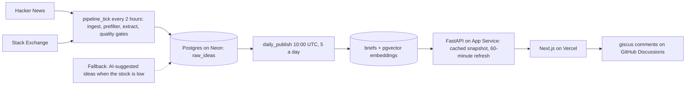

# The Problem Network

Real software needs from Hacker News and Stack Exchange, rewritten as beginner-friendly project postings.

Live: https://the-problem-network.vercel.app

## Why it exists

People keep posting "is there a tool that does X?" and nobody builds it. Students keep asking what to build for a portfolio. The Problem Network connects the two: it turns real requests into structured postings with a difficulty level, a recommended tech stack, learning outcomes and first steps.

## Features

- A list of postings with a "Load more" button that reaches every posting, including the oldest.
- Search and a tech stack filter. Both match partial words, ignore case and understand aliases such as js and javascript.
- Sort by difficulty, and filter by difficulty.
- A Saved page for postings you bookmark (kept in your browser).
- A posting page with the problem, what to build, the recommended stack, getting started steps, learning outcomes, a link to the original post and comments.
- New postings every day.
- Light and dark themes.

## How it updates every day

Everything runs in Azure Functions on UTC timers, with no manual review. `pipeline_tick` runs every 2 hours (`0 0 */2 * * *`) with an 8-minute budget. Each run searches Hacker News (Ask HN stories, through the Algolia API) and seven Stack Exchange sites over a 3-year window, drops short and noisy posts, has a language model turn the rest into structured postings, and runs quality gates (structure, red flags, overlap with the source post, duplicates at 0.85 cosine similarity using pgvector embeddings, and a 0-100 score). Everything is stored in Postgres on Neon. A posting is published only after it passes the gates.

`daily_publish` runs at 10:00 UTC and publishes 5 postings a day, best first, with real-sourced postings ranked ahead of AI-suggested ones. On Wednesday, Saturday and Sunday it may publish fewer when at least 3 passed; on other days, or with fewer than 3, it publishes what exists and records the shortfall. The same posting is never published twice. The pipeline keeps a buffer of at least 15 passed, unpublished postings and warns when it drops below 5. It stays within the free Gemini quota and stops cleanly when the quota runs out. The older `daily_extraction` timer (09:00 UTC) still exists but does nothing while automation is on.

The API loads every posting once into a cached snapshot (card columns only, no embeddings) and filters, sorts and pages it in memory. The snapshot refreshes every 60 minutes while the old copy keeps being served. New postings usually appear within about an hour, and the first visit after a quiet period may show the previous list until the next background refresh.
## Tech stack

| Layer | Technology |
|---|---|
| Frontend | Next.js 14, React 18, TypeScript, Tailwind CSS, TanStack React Query, Zustand, clsx and tailwind-merge |
| Backend | Python 3.11, FastAPI, Uvicorn, Pydantic, SQLAlchemy 2, psycopg2, requests, NumPy (duplicate gate) |
| Database | PostgreSQL on Neon, pgvector (`vector(3072)` embeddings) |
| AI | Google Gemini free tier: `gemini-3.5-flash-lite` for extraction, `gemini-embedding-001` (3072 dimensions) for embeddings, through the `google-genai` SDK |
| Data sources | Hacker News (Algolia API), Stack Exchange API |
| Cloud | Azure App Service (API), Azure Functions (timers), Azure Key Vault (secrets), Vercel (frontend) |
| Comments | giscus on GitHub Discussions |

## Architecture



## Problems solved

1. **The list call read every embedding.**
   - Before: each list request loaded the 3072-dimension embedding of every posting, about 2.2 MB per call on the 54-posting test database.
   - After: it selects only the card columns, from one cached snapshot: about 15.6 KB on the first call and nothing from the database on cached calls.
2. **Search and the stack filter missed things.**
   - Before: the stack filter matched only whole entries of a posting's stack list, so partial words and aliases (js and javascript, node and nodejs, postgres and postgresql) found nothing. Search looked for one exact phrase in the title and description only.
   - After: matching runs in memory over every posting, ignores case, dots and hyphens, accepts partial words and aliases, searches the stack too, and requires every term to match.
3. **The list stopped at 200 postings.**
   - Before: the API returned at most 200 postings and the page had no way to reach the rest.
   - After: postings are paged from the snapshot (24 at a time, up to 100 per request) with a count and a Load more button, so the oldest posting is reachable.
4. **The database was queried on every request.**
   - Before: each list request ran a database query (the free database sleeps when idle).
   - After: a cached snapshot with a 60-minute refresh instead of querying on every request. A failed refresh keeps the old copy and retries after 5 minutes.
5. **The sources did not supply enough problems continuously.**
   - Before: the measured supply from Hacker News and Stack Exchange was under 1 viable posting a day, so the pipeline needed an AI-suggested fallback to fill the day.
   - After: the search terms were expanded into a phrase bank (869 phrases for Hacker News, 836 for each of seven Stack Exchange sites) searched over a 3-year window, in a resumable order: the newest 14 days every 6 hours, then every phrase, then a full sweep. This gave more data and stays inside the API limits: Stack Exchange searching stops when fewer than 1,500 requests remain of its daily quota, backoff requests are respected, busy Hacker News windows are split to stay under the search API's result cap, and throttling or errors pause that source until the next run. In a check on the test database, 30 Hacker News phrases used 32 calls and stored 389 rows, and 45% of the top 20 rows by intent score were judged valid, against 8% before. Stack Exchange yielded far less from this style of phrase, so most of the gain came from Hacker News.
6. **Publishing depended on my manual approval.**
   - Before: every posting was reviewed by hand and marked ready with a script before it could be published.
   - After: quality gates make the decision, so approval is automatic. A posting must pass all of these, in order: it is a valid or rescoped idea; its fields have the right lengths and counts and no placeholders; it has Getting Started text; it has no red flags (for example Show HN and Launch HN product pitches); it overlaps enough with its source post; and it is not a duplicate of a published posting or of a better candidate (0.85 cosine similarity). A 0-100 score then ranks what passes.
   - How it was made trustworthy: the thresholds were calibrated on the 49 postings already published, and a test checks that all of them pass the gates; published postings never exceeded 0.72 similarity to each other, which is why duplicates are cut at 0.85. The prefilter was loosened after measuring 668 extracted rows, where the strict rules would have rejected 26 of the 96 ideas later judged valid. Tests cover every gate and its boundaries, duplicates within a batch and against published postings, rescoped ideas, missing Getting Started text, extraction retries (3 attempts), time budgets, malformed model replies, and an end-to-end publish. Database tests run in a transaction that is rolled back on a separate test database. Publishing itself is limited to 5 a day, writes one record per day so a second run is a no-op, and cannot publish the same idea twice.
7. **From a laptop to Azure timers.**
   - Before: extraction and publishing ran from a local Windows scheduled task.
   - After: the pipeline timer and the 10:00 UTC publish timer run in Azure Functions, publishing at most 5 postings a day, with secrets in Azure Key Vault.
## Smaller fixes

- CORS allows only the configured origins and only GET and OPTIONS requests.
- Admin routes are off unless `ENABLE_ADMIN_ROUTES=1`, and the admin key is compared in constant time.
- Each IP is limited to 60 GET requests a minute, and the API docs are hidden unless `ENABLE_DOCS=1`.
- The Saved page requests only the ids you saved.
- Error and empty states say what went wrong and offer Retry or a clear action.

## Data sources

Postings are drawn from Hacker News and Stack Exchange and link to the original posts.

## AI-suggested postings

AI-suggested postings are only a fallback. They are added when the passed, unpublished stock falls below 15 after Hacker News and Stack Exchange have both had their turn and still did not supply enough. They are limited to 3 generation calls a day, at most 5 AI-suggested postings are published in a day, and real-sourced postings always rank first. They are marked with a small spark logo after the title and have no original source link.
## Project structure

```
backend/      FastAPI app, database models and queries, ingestion, pipeline stages, tests
frontend/     Next.js app (pages, components, API client)
functions/    Azure Functions app (timers) and deployment scripts
docs/         Decision log, progress, build order, design notes
```

## License

MIT. See [LICENSE](LICENSE). Copyright (c) 2026 Sohan Mirpuri.
