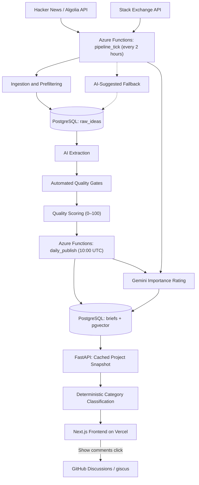

# The Problem Network

**Discover real-world software problems. Build projects that solve them.**

The Problem Network is a full-stack web application that transforms real software requests from Hacker News and Stack Exchange into structured, beginner-friendly development projects.

Instead of relying on generic project ideas, developers can explore problems that real people have encountered, discover relevant technologies, and follow actionable starting points to build practical portfolio projects.

[Explore the Live Application](https://the-problem-network.vercel.app/)

## Overview

Finding a meaningful software project can be surprisingly difficult.

Developers often struggle to identify projects that go beyond common tutorials, while online communities are filled with people describing problems they wish software could solve.

The Problem Network bridges that gap.

The application collects software-related requests from public discussion platforms, processes them using an AI-assisted extraction pipeline, and organizes them into actionable project briefs.

Each brief provides:

- **Problem Statement:** The real-world challenge that inspired the project.
- **Project Scope:** What a developer could build to address the problem.
- **Difficulty Level:** A classification to help developers find suitable challenges.
- **Recommended Tech Stack:** Suggested technologies for implementation.
- **Getting Started:** Practical steps for beginning development.
- **Learning Outcomes:** Skills and concepts developers can gain.
- **Real-World Importance:** An estimated rating of how much the problem matters to the people facing it.
- **Category:** A classification to help developers browse related problems.
- **Original Source:** A link to the discussion that inspired the project, when available.

The result is a growing collection of practical project opportunities designed to connect learning with real-world software needs.

## Key Features

### Project Discovery

Browse a collection of development opportunities with tools designed to make finding relevant projects easier.

- **Full-Text Search:** Search across titles, descriptions, and technologies using case-insensitive, partial-word matching.
- **Technology Filtering:** Find projects by technology, including common aliases such as `js`/`javascript` and `postgres`/`postgresql`.
- **Difficulty Filtering and Sorting:** Browse projects according to their complexity.
- **Importance Filtering:** Filter projects by High, Medium, or Everyday importance, with an estimated importance badge on project cards and detail pages.
- **Category Navigation:** Explore nine project categories plus Other, with a desktop sidebar, mobile-friendly scrolling chips, and category counts.
- **Shareable Category Links:** Category selections are reflected in the URL, allowing navigation through links and browser history.
- **Incremental Pagination:** Load projects in batches of 24 without losing access to older entries.
- **Saved Projects:** Bookmark interesting projects using browser-based storage.
- **Detailed Project Briefs:** Explore implementation suggestions, recommended stacks, learning outcomes, original discussions, and comments.
- **Click-to-Load Comments:** GitHub-powered comments load only when a visitor selects Show comments.
- **Publication Freshness:** A status indicator shows Live, Update delayed, or Can't reach data based on the latest posting information.
- **Light and Dark Themes:** Switch between visual themes.

### AI-Assisted Project Generation

The ingestion and processing workflow converts unstructured community discussions into standardized development briefs.

It combines:

- Public API ingestion from Hacker News and Stack Exchange.
- Early filtering to remove short or low-quality candidates.
- Structured information extraction using Google Gemini.
- Semantic duplicate detection using vector embeddings and cosine similarity.
- Automated quality gates that validate project structure, source relevance, content quality, and uniqueness.
- Quality scoring and scheduled publication of the best-scoring project briefs.
- AI-assisted importance ratings based on problem severity, frequency, and reach, with the final importance level calculated in code.

This separates content discovery and processing from public distribution, allowing only projects that pass the automated quality gates to become visible.

### Privacy

The application includes privacy-conscious design decisions across its frontend and backend.

- **No Cookies, Analytics, or Ads:** The application does not use cookies, analytics services, or advertising.
- **Hashed-IP Rate Limiting:** IP addresses are used only to generate salted hashes held in application memory for rate limiting.
- **Self-Hosted Fonts:** IBM Plex Sans is served from the application's own domain rather than requested from Google when a page loads.
- **Click-to-Load Comments:** No GitHub or giscus requests are made for comments until a visitor chooses to load them.
- **Privacy Documentation:** The `/privacy` page explains browser storage, rate limiting, and the GitHub Discussions data flow.

Hosting-platform logging is outside the application's control.

## Technology Stack

| Layer | Technologies |
|---|---|
| Frontend | Next.js 14, React 18, TypeScript, Tailwind CSS |
| Client State and Data Fetching | Zustand, TanStack React Query |
| UI Utilities | clsx, tailwind-merge |
| Fonts | IBM Plex Sans, next/font/google |
| Backend | Python 3.11, FastAPI, Pydantic, SQLAlchemy 2, Uvicorn |
| Data Processing | NumPy, requests, psycopg2 |
| Database | PostgreSQL (Neon), pgvector |
| AI Processing | Google Gemini, Google GenAI SDK |
| Scheduling | Azure Functions |
| Backend Hosting | Azure App Service |
| Frontend Hosting | Vercel |
| Secret Management | Azure Key Vault |
| Community Discussion | giscus, GitHub Discussions |

**AI models**

- `gemini-3.5-flash-lite` — Structured project extraction and real-world importance scoring.
- `gemini-embedding-001` — 3,072-dimensional vector embeddings for semantic comparison.

## System Architecture

The application uses a decoupled architecture that separates data ingestion, AI processing, publication, API delivery, and frontend presentation.



Ingestion, AI processing, quality validation, importance rating, and publishing all run automatically in Azure Functions. The `pipeline_tick` workflow is enabled in production through `AUTOMATION_ENABLED=true`, and publication requires no manual approval. The legacy `daily_extraction` timer remains scheduled but does nothing while automation is enabled.

The backend also handles deterministic category classification. Comments are loaded separately from GitHub Discussions only after a visitor requests them.

## Data Processing Pipeline

### 1. Source Ingestion

The `pipeline_tick` Azure Function runs every two hours:

`0 0 */2 * * *`

It retrieves candidate software requests from:

- **Hacker News:** Ask HN discussions accessed through the Algolia API.
- **Stack Exchange:** Questions retrieved from seven Stack Exchange sites through the Stack Exchange API.

The pipeline searches across a three-year window and stores retrieved candidates in the PostgreSQL `raw_ideas` table. It works through a bank of several hundred search phrases per source, newest posts first.

The legacy `daily_extraction` function remains scheduled at 09:00 UTC but does nothing while `AUTOMATION_ENABLED=true`.

### 2. AI Extraction and Validation

The automated pipeline prepares source material for conversion into structured project briefs.

The workflow:

- Removes short and noisy submissions before invoking an AI model.
- Uses Gemini to extract structured project information.
- Generates embeddings for semantic comparison.
- Passes extracted projects through automated quality gates.
- Scores qualifying projects for publication priority.

Filtering candidates before model inference helps avoid unnecessary API usage.

### 3. Automated Quality Gates

Every extracted project must pass a sequence of validation checks before becoming eligible for publication.

The gates run in the following order:

1. **Idea Validity:** Confirms that the idea represents a valid software project.
2. **Structure and Completeness:** Validates field lengths and counts and rejects placeholder content.
3. **Getting Started:** Requires actionable Getting Started text.
4. **Red Flags:** Rejects unsuitable submissions, including Show HN and Launch HN product pitches.
5. **Source Relevance:** Verifies sufficient overlap between the generated project and its original source.
6. **Duplicate Detection:** Rejects projects that duplicate a published posting or a better candidate using a 0.85 cosine-similarity threshold.

Projects that pass all gates receive a 0–100 quality score used to determine publication priority.

The thresholds were calibrated against the first 49 published postings. Automated tests cover every gate and its boundaries, duplicate detection, retries, and an end-to-end publishing workflow.

No manual approval is required.

### 4. Scheduled Publication

The `daily_publish` Azure Function runs at 10:00 UTC.

It:

- Publishes five qualifying projects per day, prioritizing the highest quality scores.
- Ranks real-source projects ahead of AI-suggested projects.
- Publishes at least three projects on Wednesday, Saturday, and Sunday when sufficient qualifying candidates are available.
- Publishes whatever is available and records the shortfall when fewer projects are ready.
- Prevents the same project from being published more than once.
- Rates newly published projects for real-world importance.

The publishing process runs automatically using the results of the quality validation and scoring pipeline.

### 5. AI-Suggested Fallback

AI-suggested projects provide a fallback when public sources do not generate enough qualifying project briefs.

The fallback activates only when the stock of passed, unpublished projects falls below 15 after both Hacker News and Stack Exchange have been processed and still have not supplied enough candidates.

The fallback:

- Allows no more than three generation calls per day.
- Limits publication to a maximum of five AI-suggested projects per day.
- Marks AI-suggested projects with a small spark logo.
- Does not provide an original source link for AI-suggested projects.

Real-source projects always receive publication priority over AI-suggested projects.

### 6. Real-World Importance Rating

Projects receive an estimated importance rating based on three factors:

- **Severity:** How serious the consequences are if the problem remains unsolved.
- **Frequency:** How often affected people encounter the problem.
- **Reach:** How many people experience the problem.

Each factor receives a score from 0 to 2. The application calculates the final importance level using predefined rules rather than allowing the model to choose the level directly.

| Rating | What It Means |
|---|---|
| High | A serious problem affecting income, health, safety, important data, or other significant interests, which also occurs frequently or affects a sufficiently large group. |
| Medium | A serious problem that occurs less frequently or affects a smaller group, or a moderately costly problem that is widespread or recurring. |
| Everyday | A minor inconvenience or improvement to an existing process, or a moderately costly problem that is uncommon and affects relatively few people. |

AI-suggested and web-grounding projects are capped at Medium, even if their calculated rating would otherwise be High.

The rating process:

- Uses one Gemini call per project.
- Rates up to five older unrated projects per `pipeline_tick`.
- Rates new projects through `daily_publish`.
- Limits usage to 60 calls per Pacific quota day.
- Spaces calls five seconds apart.
- Allows up to three failed attempts per project.
- Stops on quota errors without counting them as failed attempts.
- Records runs in `pipeline_runs` under the `importance` stage.

Importance data is stored in `briefs.importance` and `briefs.importance_detail`.

Unrated projects remain available for browsing but do not match an importance filter.

### 7. Category Classification

Projects are assigned to categories using a deterministic keyword classifier rather than additional AI model calls.

The classifier is implemented in `backend/categories.py` and runs when the API's cached snapshot is built.

It uses whole-word keyword matching with weighted fields:

| Field | Weight |
|---|---|
| Title | 3 |
| Recommended tech stack | 2 |
| Core task | 1 |

Generic stack terms such as `api`, `apis`, `html`, and `css` are ignored. When multiple categories receive the same score, the first category in the configured order wins.

The application provides nine categories plus Other:

1. AI and Machine Learning
2. Developer Tools
3. Data and Analytics
4. Productivity and Automation
5. Security and Privacy
6. Mobile Apps
7. Media, Games and Creative
8. Money, Work and Business
9. Health, Home and Everyday Life
10. Other

Category classification does not require additional AI model calls.

## Backend Performance and Engineering

Beyond building the core application, a major focus of the project has been improving backend efficiency, scalability, and reliability.

### 1. Eliminating Unnecessary Embedding Transfers

**Problem**

The original project-list endpoint retrieved full database records, including 3,072-dimensional vector embeddings that the frontend never used.

On a test database containing 54 projects, this resulted in approximately 2.2 MB of database data transferred per listing request.

**Solution**

Reworked the listing endpoint to select only the fields necessary for project cards and serve results from an in-memory cached snapshot.

**Measured result**

| Metric | Before | After |
|---|---|---|
| Data retrieved for initial listing | ~2.2 MB | ~15.6 KB |
| Embeddings included | Yes | No |
| Database read on a cached listing request | Yes | No |

This reduced initial listing data transfer by approximately 99.3% in the measured test scenario.

### 2. Implementing an In-Memory Query Cache

**Problem**

Every listing request originally triggered a PostgreSQL query, creating unnecessary database activity.

This was especially undesirable when using a free-tier database that can become idle.

**Solution**

Implemented an in-memory snapshot containing only project-card fields.

The API now performs filtering, sorting, searching, and pagination against the cached snapshot.

The cache provides:

- A 60-minute refresh interval.
- Continued service from the previous snapshot while a refresh runs.
- A single background refresh instead of overlapping refresh operations.
- Preservation of the last successful snapshot if a refresh fails.
- A five-minute retry interval after refresh failures.

**Result**

Repeated listing requests can be handled without additional database reads, while newly published projects usually become available within about an hour. The first visit after a quiet period may still show the previous list until the next background refresh.

### 3. Building More Flexible Search and Filtering

**Problem**

The original implementation relied on exact matching and limited searchable fields.

This meant that searches involving technology aliases, partial words, or multiple terms could fail to return relevant projects.

**Solution**

Implemented a normalized search system that:

- Ignores capitalization.
- Handles punctuation differences, including dots and hyphens.
- Supports partial-word matching.
- Recognizes common technology aliases.
- Searches project titles, descriptions, and recommended technologies.
- Requires all search terms to match, potentially across different searchable fields.
- Supports importance and category filtering alongside existing search and difficulty filters.

Category filtering uses the `category` query parameter, while importance filtering uses `importance`. Both are supported by `GET /briefs/`.

Importance values are matched case-insensitively, and unrated projects do not match an importance filter. Unknown category slugs return no matching projects.

The API also returns `category_counts`, calculated using all active filters except category, so each count represents how many projects would appear if that category were selected.

**Result**

Developers can discover relevant projects without needing to know the exact terminology used in their descriptions.

Search, technology, difficulty, importance, category, sorting, and pagination work together, while category counts help users navigate the filtered collection.

### 4. Removing the 200-Project Listing Limit

**Problem**

The previous API returned no more than 200 projects, leaving older records inaccessible from the interface.

**Solution**

Introduced backend pagination using the cached snapshot and a frontend Load More interaction.

- Default page size: 24 projects.
- Maximum page size: 100 projects.
- Total result count returned by the API.
- Incremental loading from the frontend.
- Pagination compatible with category, importance, difficulty, technology, search, and sorting filters.

**Result**

Users can navigate the entire project collection, including the oldest entries, without retrieving all projects at once.

### 5. Migrating Scheduled Workloads to Azure

**Problem**

The initial ingestion and publishing schedule depended on a local Windows machine and its Task Scheduler.

**Solution**

Moved ingestion, automated processing, and publication scheduling to Azure Functions.

- `pipeline_tick` — Every two hours, handling ingestion, extraction, quality validation, and importance-rating catch-up.
- `daily_publish` — 10:00 UTC, including importance ratings for newly published projects.
- `daily_extraction` — 09:00 UTC (inactive while automation is enabled).
- The Azure Functions deployment bundle includes `pipeline/importance.py`.
- Secrets managed through Azure Key Vault.
- PostgreSQL hosted on Neon.

The importance pipeline uses the existing `GEMINI_API_KEY` and `DATABASE_URL` settings.

**Result**

The automated pipeline no longer depends on a personal computer remaining powered on.

Importance rating also runs through the deployed Azure Functions application.

### 6. Improving the Supply of Viable Project Ideas

**Problem**

Hacker News and Stack Exchange initially supplied fewer than one viable project per day, which made a continuous publishing schedule difficult and led to the introduction of an AI-suggested fallback.

**Solution**

Replaced the original narrow searches with a large bank of search phrases: 869 for Hacker News and 836 for each of the seven Stack Exchange sites. These are searched across a three-year window in a resumable order: the newest 14 days every 6 hours, then every phrase, then a full sweep. The searches stay within each source's API limits:

- Stack Exchange searching stops when fewer than 1,500 requests remain in its daily quota.
- Backoff requests from the API are respected.
- Busy Hacker News time windows are split to stay under the search API's result cap.
- Throttling or errors pause that source until the next run.

**Result**

In a test-database check using 30 Hacker News phrases, 45% of the top 20 rows by intent score were valid, compared with 8% before the change. Most of the gain came from Hacker News, since Stack Exchange yielded far less from this style of phrase.

### 7. Automating Project Approval

**Problem**

Publishing originally depended on manual approval, creating a bottleneck in the content pipeline.

**Solution**

Implemented automated quality gates and thorough testing. Gate thresholds were calibrated using the first 49 published projects, with tests covering gate boundaries, duplicate detection, retries, and end-to-end publishing.

**Result**

Projects that pass all validation gates can now be scored and published automatically without manual approval.

### 8. Making Publication Freshness More Accurate

**Problem**

The original header always displayed Live, regardless of whether new projects had been published.

An initial schedule-based implementation used the expected 10:00 UTC publication time plus a three-hour grace period. However, during the 10:00–13:00 UTC window, it could still display Live even when the previous day's publication had been missed.

**Solution**

Replaced schedule-based calculations with a simpler age-based rule using the `last_updated` value already returned by the existing statistics endpoint.

| State | Condition |
|---|---|
| Live | Newest posting is less than 27 hours old, including timestamps in the future |
| Update delayed | Newest posting is at least 27 hours old, or no timestamp is available |
| Can't reach data | The freshness data cannot be retrieved |

The 27-hour threshold represents the 24-hour publication cadence plus a three-hour grace period.

The implementation:

- Runs entirely in the browser without backend changes.
- Uses one `setTimeout` at the 27-hour threshold to refetch the statistics.
- Caps timer delays at `2^31-1` milliseconds.
- Uses an accessible `role="status"` indicator with text labels and supporting dot colors.
- Displays an orange ripple for Live, a warning dot for delayed updates, and an error dot when data is unavailable.
- Disables the ripple animation when `prefers-reduced-motion` is enabled.

The implementation is located in `frontend/lib/freshness.ts` and `frontend/components/FreshnessStrip.tsx`.

**Result**

The freshness indicator now reflects the age of the latest published project rather than relying on an expected publication schedule.

The simpler age-based rule reduces edge cases, and five unit tests cover the freshness behavior.

### 9. Adding Real-World Importance Ratings

**Problem**

Difficulty describes how challenging a project is to implement, but it does not indicate how much the underlying problem matters to the people experiencing it.

**Solution**

Implemented an AI-assisted importance-rating pipeline that evaluates severity, frequency, and reach, each scored from 0 to 2.

The final High, Medium, or Everyday classification is computed in Python rather than selected directly by the model.

The implementation includes:

- An importance-rating pipeline with quota limits, retries, and failure tracking.
- A dry-run-first backfill tool for existing projects.
- An importance API filter and badges on project cards and detail pages.
- A tooltip explaining that importance is an estimate rather than a measurement.

The backfill tool, `tools/backfill_importance.py`, supports:

- Default dry-run behavior.
- `--apply` to write changes.
- `--limit N` to restrict the number of projects.
- `--production` as an additional requirement on databases without `test_branch_marker`.

**Result**

Test-branch calibration across 53 projects produced:

| Importance | Projects |
|---|---:|
| High | 2 |
| Medium | 15 |
| Everyday | 36 |
| **Total** | **53** |

The feature includes 17 backend tests and four frontend tests.

### 10. Adding Category Navigation

**Problem**

As the project collection grew, developers needed a way to browse related ideas without relying exclusively on search terms and individual filters.

**Solution**

Implemented deterministic category classification and responsive category navigation.

The frontend provides:

- A 256px-wide category sidebar on desktop at widths of 1024px and above.
- A horizontally scrolling row of category chips on smaller screens.
- All as the first and default selection.
- Category selections persisted in the URL using `?category=...`.
- Browser back-button and shareable-link support.
- Accessible `aria-current` indicators and visible focus outlines.
- An empty state with a Show all postings link.

The navigation remains hidden until the API returns category counts, allowing the frontend to be deployed before the corresponding API changes.

The classifier was refined after an initial run placed 77 projects in Developer Tools and 13 in Other because generic technology terms inflated Developer Tools scores.

Keyword tuning reduced the Other count to zero. Merging smaller categories was considered but not implemented.

A `tailwind-merge` conflict that removed `text-small` when combined with `text-text` was also corrected.

**Result**

The category distribution across 194 production projects was:

| Category | Projects |
|---|---:|
| AI and Machine Learning | 27 |
| Developer Tools | 50 |
| Data and Analytics | 16 |
| Productivity and Automation | 38 |
| Security and Privacy | 2 |
| Mobile Apps | 3 |
| Media, Games and Creative | 22 |
| Money, Work and Business | 21 |
| Health, Home and Everyday Life | 15 |
| Other | 0 |
| **Total** | **194** |

The feature includes 12 backend tests and five frontend tests.

At this stage, the test suites contained **202 Python tests (one skipped)** and **19 frontend tests**.

### 11. Reducing Unnecessary Third-Party Requests

**Problem**

The frontend previously loaded Google-hosted font resources and the GitHub-powered comments component without requiring an explicit visitor action.

**Solution**

Moved IBM Plex Sans to Next.js font hosting and changed comments to load on demand.

Font changes:

- Uses `next/font/google` with weights 400, 500, and 700.
- Uses `display: swap` and the CSS variable `--font-plex`.
- Downloads font files at build time and serves them from the application's own domain.
- Removes the Google Fonts stylesheet and Google font-domain preconnects.
- Removes the unused font weight 800.

Comment changes:

- Displays a Show comments button.
- Explains: "Comments load from GitHub only after you click."
- Uses `next/dynamic` with `ssr: false`.
- Loads `@giscus/react` only after the button is clicked.

**Result**

Page loads no longer request font assets from Google, and GitHub or giscus requests for comments do not occur until a visitor explicitly opens the comments section.

## API Security and Reliability

Several safeguards are included in the backend implementation:

- **Restricted CORS:** Only configured origins are allowed, with GET, POST, and OPTIONS methods.
- **Protected Administrative Routes:** Admin endpoints are disabled unless `ENABLE_ADMIN_ROUTES=1`.
- **Constant-Time Key Comparison:** Administrative key validation uses constant-time comparison.
- **Rate Limiting:** General GET requests are limited to 60 per minute per client.
- **Hashed-IP Limiter Keys:** Rate limits use a SHA-256 hash of the client IP address combined with a random 16-byte salt generated per process. Raw IP addresses are not retained by the limiter, even in memory.
- **In-Memory Rate Limiting:** Limits apply per application instance and reset when the process restarts.
- **Restricted API Documentation:** Interactive documentation is disabled unless `ENABLE_DOCS=1`.
- **Resilient Caching:** Previously loaded data remains available during failed refresh attempts.
- **Targeted Saved-Project Retrieval:** The Saved page requests only bookmarked project IDs.
- **User-Friendly Error Handling:** Empty and failed states provide appropriate explanations and recovery actions.

## Project Structure

```
backend/
    FastAPI application
    Database models and queries
    Ingestion and AI processing
    Pipeline stages
    categories.py
        Deterministic project category classifier
    tools/
        Importance-rating backfill utility
    Backend tests

frontend/
    Next.js application
    Reusable UI components
    API client
    Project discovery and saved pages
    Freshness status components and logic
    Category navigation
    Importance filtering
    Click-to-load comments
    Privacy page

functions/
    Azure Functions application
    Scheduled ingestion and publication
    Importance-rating deployment bundle
    Deployment scripts

docs/
    Architectural decisions
    Development progress
    Build order
    Design and implementation notes
```

## Data Sources and Attribution

Projects are derived primarily from publicly available discussions on Hacker News and Stack Exchange.

Source-based project briefs retain links to their original discussions so developers can explore the context and motivation behind each idea.

AI-suggested projects are generated only as a fallback when both Hacker News and Stack Exchange fail to supply enough qualifying projects. These postings are identified by a small spark logo and do not include an original source link.

The application transforms source discussions into structured development challenges rather than presenting them as complete implementations.

## Privacy and Data Handling

The application avoids cookies, analytics services, and advertising.

Rate limiting uses salted SHA-256 hashes of client IP addresses. The random salt is generated per application process, and the limiter does not retain raw IP addresses. Hosting-platform logs remain outside the application's control.

The application uses browser storage for:

- `theme` — Theme preference.
- `favoriteBriefs` — Saved projects.
- `giscus-session` — GitHub-powered comments integration.

IBM Plex Sans is self-hosted through Next.js, and comments are requested from GitHub and giscus only after a visitor selects Show comments. Comment content is stored in a GitHub repository through GitHub Discussions.

Additional information is available on the application's `/privacy` page.

## Current Status

The application is deployed and accessible at:

[https://the-problem-network.vercel.app](https://the-problem-network.vercel.app/)

The full automated pipeline is live in production with `AUTOMATION_ENABLED=true`. Azure Functions handles ingestion, AI extraction, quality validation, scoring, and scheduled publication without manual approval.

## License

This project is licensed under the MIT License. See [LICENSE](LICENSE) for details.

Copyright © 2026 Sohan Mirpuri.
